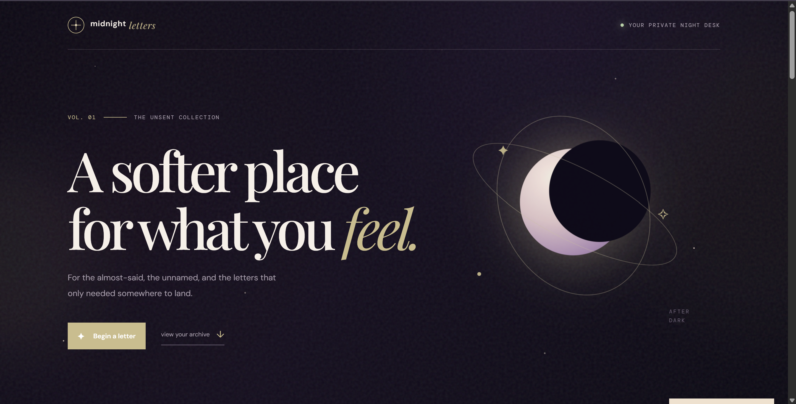
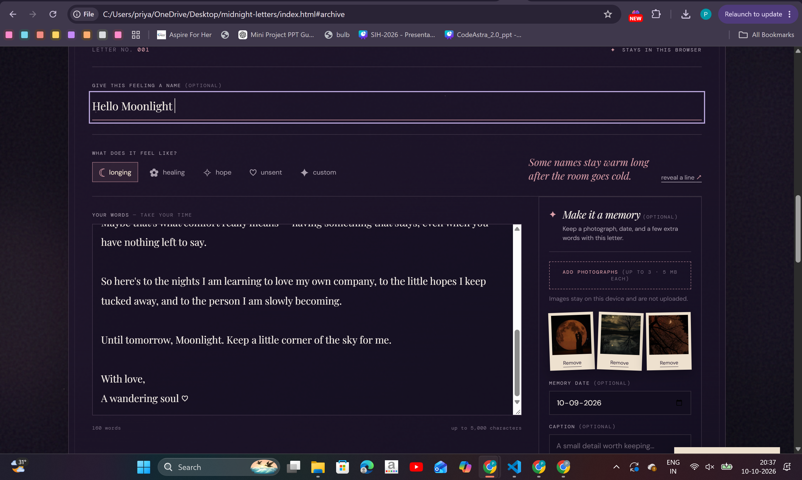
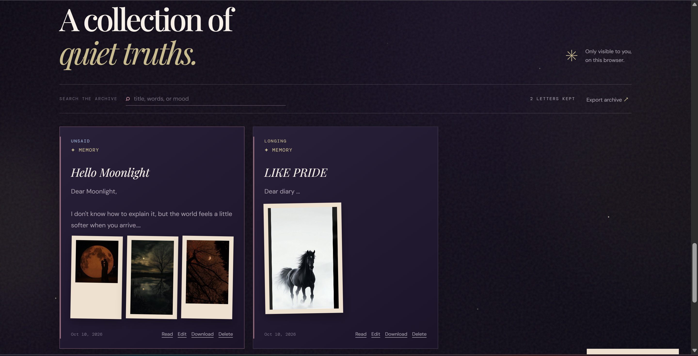

# Midnight Letters ✳

*A quiet little corner for the words you never sent.*

Midnight Letters is a small, responsive writing space for unsent letters, private thoughts, and feelings that need somewhere to land. It was designed as a simple front-end project that can be explored and extended with GitHub Copilot.

## Features

- **Writing prompts:** rotate through gentle prompts when you need a starting point.
- **Mood-aware UI:** picking longing, healing, hope, or unsent shifts the accent colour and reveals a short original line (with a *reveal a line* button).
- **Mood tags:** each letter is saved with its mood.
- **Custom moods:** choose your own mood name and accent colour for a letter.
- **Read in place:** expand any saved letter to read it in full.
- **Local archive:** save letters in your browser with `localStorage`.
- **Download a letter:** export any saved letter as a `.txt` file.
- **Export all:** download the whole archive as a text file.
- **Delete letters:** remove individual letters from the local archive.
- **Make it a memory:** optionally attach up to three local photographs, a date, caption, and poem or quote to a letter. Memories can be edited and are included in text exports.
- **Responsive design:** layouts adapt to desktop and mobile screens.
- **Accessibility basics:** semantic sections, form labels, visible keyboard focus, reduced-motion support, and live status messages.

## Run locally

No package installation or build step is required.

1. Download or clone this repository.
2. Open `index.html` in your browser.
3. Write a letter, choose a mood, and select **Keep this letter**.

For a local development server, you can also use the VS Code **Live Server** extension.

## Tech stack

- HTML5
- CSS3
- Vanilla JavaScript
- Browser `localStorage`, IndexedDB, and Blob download APIs

## Privacy note

Letters and memory text are stored in the current browser's local storage. Memory photographs are stored as image blobs in this browser's IndexedDB and are never uploaded. This project does not send letters or photographs to a server (the page only loads fonts from Google Fonts). Anyone with access to the same browser profile may be able to access them, and clearing browser site data may remove them. Use **Export archive** to keep a text backup; photographs are not included in text exports. This is a personal journaling demo, not a secure vault.

## GitHub Copilot challenge

This project is suitable for the Global Hack Week challenge **“Use GitHub Copilot to Build a Simple Application.”** To complete the challenge honestly:

1. Open the project in VS Code with GitHub Copilot enabled.
2. Use the prompts in [`COPILOT_PROMPTS.md`](COPILOT_PROMPTS.md) to ask Copilot to explain, review, or extend parts of the app.
3. Test any changes Copilot suggests and keep only changes you understand.
4. Record the prompts you actually used and the results in [`COPILOT_LOG.md`](COPILOT_LOG.md). Do not claim a prompt was used if you did not use it.
5. Commit the project to your GitHub account and submit the repository URL plus a screenshot of the running app.

## Suggested screenshot

Run `index.html` and take a screenshot showing the hero section and the writing form, or write a short sample letter and show it in the archive. Do not include personal/private writing in a public screenshot.

## Demo screenshots

These screenshots show the current visual design and archive experience:

## Features

### Writing sanctuary

- Rotate through gentle writing prompts when you need a starting point.
- Write letters with an optional title, body text, mood, and live word count.
- Choose Longing, Healing, Hope, Unsent, or create a custom mood.
- Give a custom mood its own name and accent colour.
- Receive a short mood-specific line with the reveal interaction.
- Start over at any time without leaving the composer.

### Personal archive

- Save letters privately in the current browser.
- Search saved letters by title, body text, mood, memory date, caption, or poem/quote.
- Read letters in place without leaving the page.
- Edit saved letters and update their mood or memory details.
- Delete individual letters with confirmation.
- Download one letter or export the complete archive as plain text.

### Make it a memory

- Optionally attach up to three photographs to a letter.
- Preview, remove, or replace selected photographs before saving.
- Add a memory date, caption, poem, or favourite quote.
- View memories as scrapbook-style archive cards.
- Store photographs locally in IndexedDB, separate from the letter text.
- Continue reading letters if a stored photograph is missing or unavailable.

### Thoughtful experience

- Responsive layouts for desktop and mobile screens.
- Keyboard-operable controls with visible focus states.
- Clear empty states and validation messages.
- Reduced-motion support for users who prefer less animation.
- No framework, build process, account, tracking, or external upload service.

## Possible future improvements

- Add a light theme toggle.
- Add a downloadable Markdown export.
- Add a confirmation before exporting or clearing all data.

## License

This project is licensed under the [MIT License](LICENSE).
